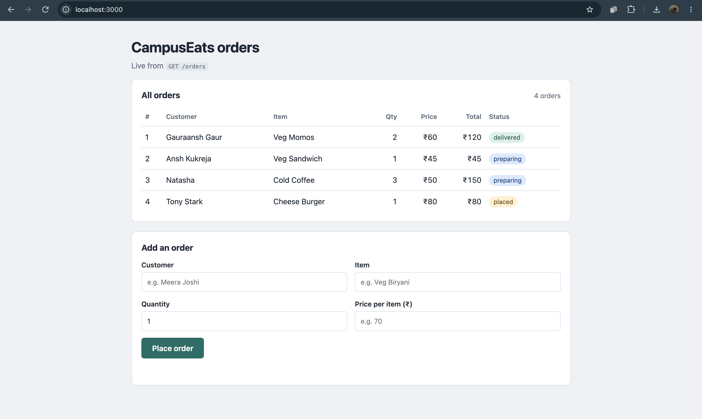
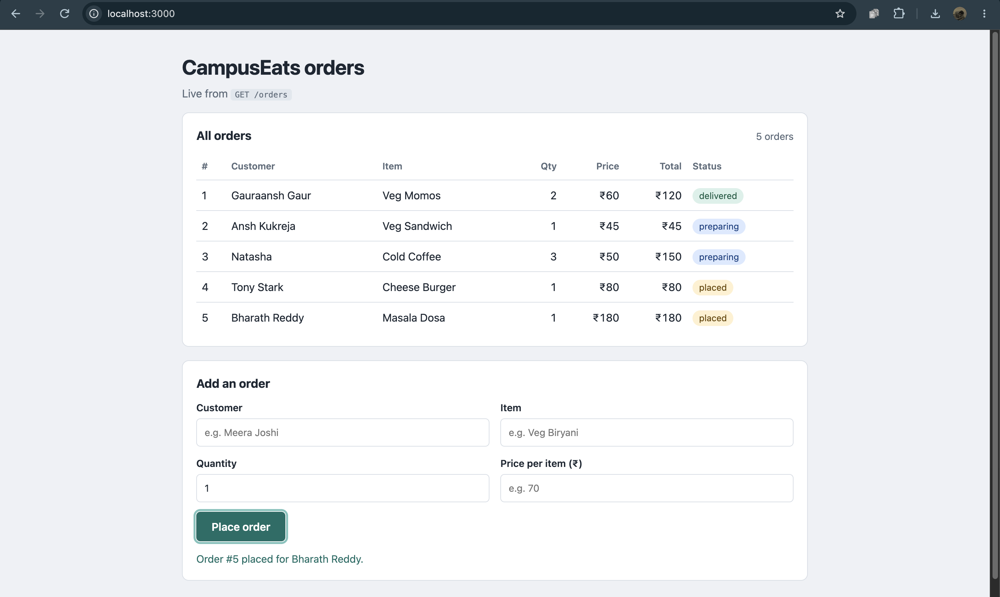

## CampusEats Assignment 8 - CS-543 (Web Services)

### Team ID : 6


- <b>Name</b> : Gauraansh Gaur </br>
  <b>Roll no</b> : 20251651039
</br>

- <b>Name</b> : Shraiyansh Chaware </br>
  <b>Roll no</b> : 20251651085
</br>

- <b>Name</b> : Abhishek Yadav </br>
  <b>Roll no</b> : 20251651007
</br>

- <b>Name</b> : Utkarsh Singh </br>
  <b>Roll no</b> : 20251651099
</br>

- <b>Name</b> : Jatin Mandwani </br>
  <b>Roll no</b> : 20251651048
</br>


<br>
<br>

### Run the Project
```
npm install

node server.js

visit -> http://localhost:3000
```

<br>
<br>

## Screenshot (Before)


## Screenshot (After)



<br>
<br>


## Answers

### 1. Which CampusEats service did we pick, and what are its routes?

We picked **Orders** (fields: `id`, `customer`, `item`, `quantity`, `price`, `status`).

```
GET /orders  -> List all orders 
GET /orders/:id  -> Fetch one order 
POST /orders  -> Create a new order 
```

### 2. Which status codes did we return, and for which outcomes?

```
200 GET /orders  -> succeeded
201 POST /orders  -> created a new order
404 GET /orders/:id  -> with an id that does not exist 
422 POST /orders  -> with a missing or invalid field (customer, item, quantity, price)
```

### 3. Where did we use req.params and where req.body? Why does POST need express.json()?

- `req.params.id` is used in `GET /orders/:id`. The id is part of the URL path.

- `req.body` is used in `POST /orders`. The new order's data is sent as JSON in the request body, not in the URL.

- Express does not read the body by default, so `req.body` would be `undefined`. `app.use(express.json())` parses the incoming JSON text and puts the resulting object on `req.body`.
